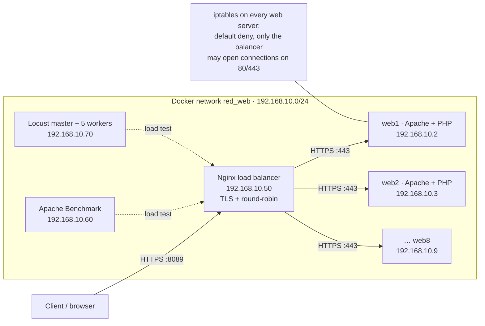

# Web Server Farm

A containerized web server farm: an Nginx HTTPS load balancer in front of eight Apache + PHP servers, each with its own iptables firewall, plus load tests with Apache Benchmark and Locust.


-4EAA25?style=flat-square&logo=gnubash&logoColor=white)


## Architecture



## Features

- **HTTPS load balancing:** Nginx terminates TLS (HTTP/2) and spreads requests round-robin across 8 Apache backends, re-encrypting the traffic to each backend. The PHP page shows which server answered, so you can watch the rotation.
- **Hardened backends:** Apache serves only TLS 1.2+ with strong ciphers; each container applies an iptables policy at startup: default `DROP`, new connections on 80/443 only from the balancer, per-IP connection limits, port-scan and fragment filtering, a basic `union select` string match and ICMP rate limiting. *Known limitation:* the last rule (`recent --set … -j ACCEPT`) lets new connections from any source through until they hit the limit, so a backend can still be reached directly a few times.
- **Fixed network layout:** two user-defined Docker networks with static IPs, so the balancer, the backends and the load-testing clients always have known addresses.
- **Load testing:** Apache Benchmark (10,000 requests, 100 concurrent) and distributed Locust (1 master + 5 workers with a web UI). On my laptop (Docker Desktop on macOS) `ab` completes with 0 failed requests at roughly 1,500–1,900 requests/s.
- **One-command setup:** a Makefile generates a self-signed certificate, creates the network and starts the farm.

## Tech stack

| Technology | Used for |
|---|---|
| Docker + Docker Compose | Building the images and running the farm and the load tests as containers on fixed networks |
| Nginx | HTTPS reverse proxy and round-robin load balancer |
| Apache HTTP Server + PHP (Ubuntu 20.04) | Backend web servers serving `index.php` over TLS |
| iptables (Bash script) | Per-container firewall applied by the entrypoint |
| OpenSSL | Self-signed certificate for the balancer and the backends |
| Apache Benchmark (`ab`) | Throughput test with a fixed number of concurrent requests |
| Locust (Python) | Distributed load test simulating users with think time |
| Make | Single entry point to set up, run and tear everything down |

## Getting started

**Requirements:** Docker with Compose v2 (Docker Desktop on macOS works), `make` and `openssl` (both preinstalled on macOS). Ports used on the host: `8089` (balancer), `8080–8087` (direct access to each backend) and `8090` (Locust UI).

```bash
git clone https://github.com/josedimas23/web-server-farm.git
cd web-server-farm
make up
```

Open <https://localhost:8089> and accept the self-signed certificate warning. Reload the page to see a different backend address each time.

Load tests (with the farm running):

```bash
make bench-ab       # Apache Benchmark, prints the results and exits
make bench-locust   # Locust UI at http://localhost:8090
```

Stop everything:

```bash
make down
```

<details>
<summary>Manual steps (without make)</summary>

```bash
# 1. Self-signed certificate used by Nginx and Apache
openssl req -x509 -nodes -newkey rsa:2048 -days 365 -subj "/CN=localhost" \
  -keyout granjaweb/P4-josedimasugr-certificados/certificado_josedimasugr.key \
  -out granjaweb/P4-josedimasugr-certificados/certificado_josedimasugr.crt

# 2. Network shared by the farm and the load tests
docker network create --subnet 192.168.10.0/24 red_web

# 3. Start the farm
cd granjaweb && docker compose up -d --build
```

</details>

> If `make up` fails with `address already in use`, another program is using one of the host ports above (for example a React Native/Metro dev server on 8081). Stop it or change the port mapping in `granjaweb/docker-compose.yml`.

## Project structure

```
.
├── Makefile                          # up / down / certs / network / bench-ab / bench-locust
├── granjaweb/                        # The web farm
│   ├── docker-compose.yml            # 8 Apache backends + Nginx balancer, networks and ports
│   ├── index.php                     # Page that prints the backend's IP address
│   ├── P4-josedimasugr-apache/       # Apache image, TLS vhost, entrypoint and iptables script
│   ├── P4-josedimasugr-nginx/        # Nginx image and load-balancer config
│   └── P4-josedimasugr-certificados/ # Generated certificate and key (not versioned)
└── pruebas_carga/                    # Load tests
    ├── ab/                           # Apache Benchmark image and compose file
    └── locust/                       # Locust master/workers and locustfile.py
```

## What I learned

- How an L7 load balancer works in practice: Nginx `upstream` pools, TLS termination and re-encrypting traffic to the backends, and how to check that the rotation really happens.
- Writing iptables policies inside containers (`NET_ADMIN`, default-deny, `connlimit`, `recent`, `string`) and that rule order decides everything: while preparing this repo I found that a late `ACCEPT` rule undoes the "only the balancer" restriction.
- Small configuration details have security consequences: mounting the whole project folder into the web root made the private key downloadable over HTTPS. The fix was to mount only `index.php` and to keep certificates out of the repository.
- The difference between a raw throughput test (`ab`, fixed concurrency) and a user-behaviour test (Locust, users with think time), and how to run Locust distributed across workers.

## Context & credits

Built for the lab assignments of **Servidores Web de Altas Prestaciones (SWAP)**, part of the Computer Engineering degree at the **Universidad de Granada** (2024). All the configuration, Dockerfiles and scripts in this repository were written by me following the course lab guides; the guides and other course material are not included.

Third-party software used (downloaded at build time, not redistributed here): [Ubuntu](https://hub.docker.com/_/ubuntu) and [Debian](https://hub.docker.com/_/debian) base images, the official [Nginx](https://nginx.org/) image (BSD-2-Clause), [Apache HTTP Server](https://httpd.apache.org/) and Apache Benchmark (Apache License 2.0), [PHP](https://www.php.net/) (PHP License) and [Locust](https://locust.io/) (MIT).

Released under the [MIT License](LICENSE).
